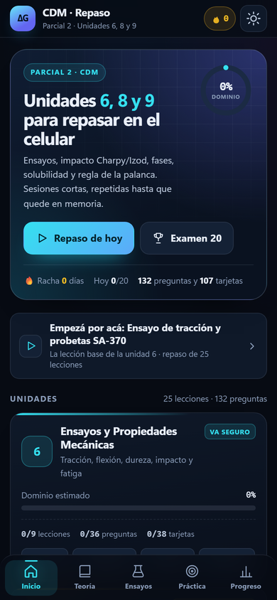
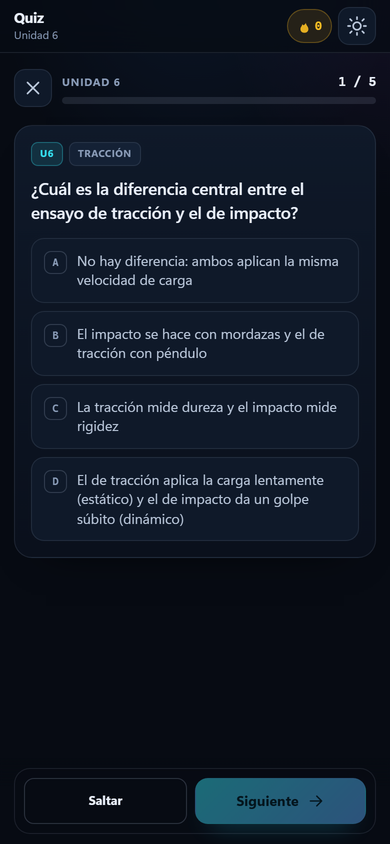
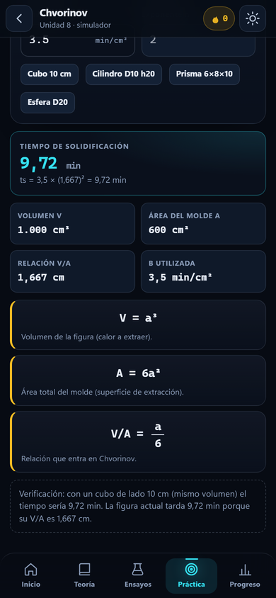
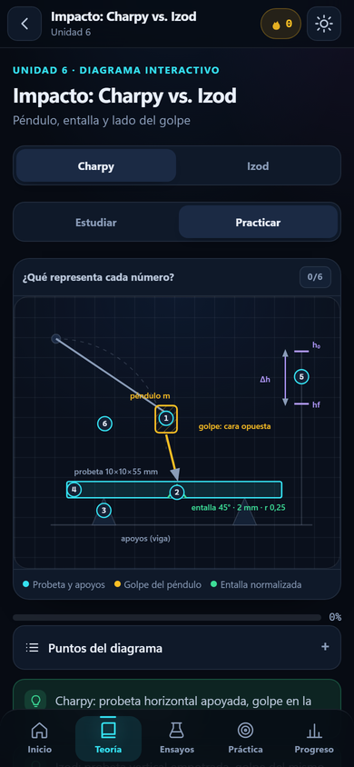
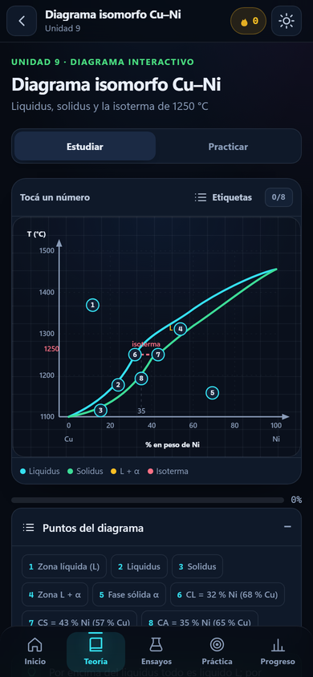
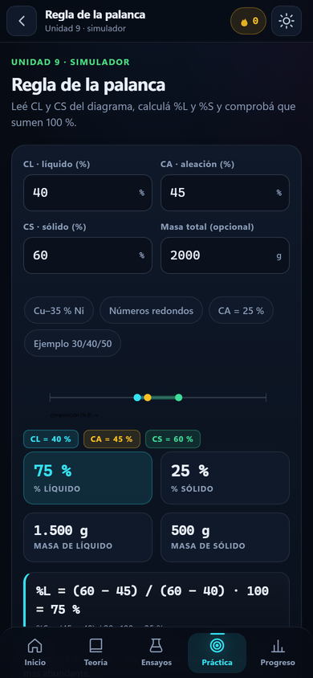
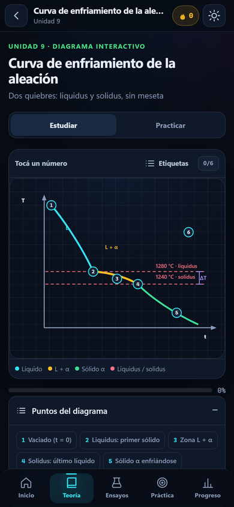
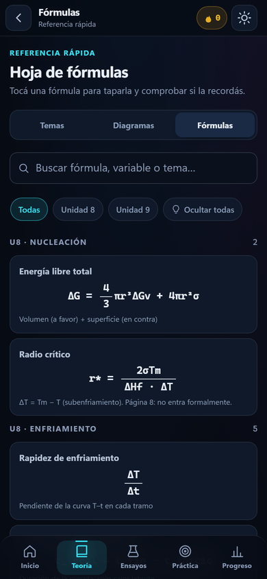
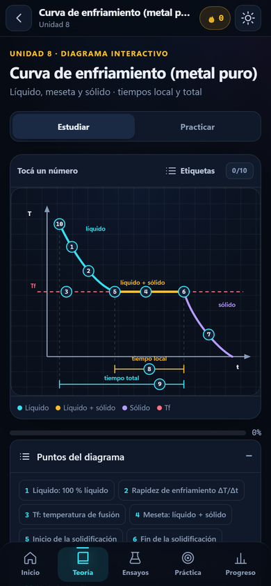

# CDM Repaso — Unidades 6, 8 y 9

App de repaso para el **Parcial 2 de Ciencia de los Materiales** (ITU, Producción Industrial Automatizada), pensada para usarse desde el celular, muchas veces y en sesiones cortas.

Contenido: **Unidad 6** (ensayos y propiedades mecánicas, con impacto Charpy/Izod en detalle), **Unidad 8** (nucleación, grano fino, Chvorinov y volumen/área de figuras) y **Unidad 9** (fases, solubilidad, diagrama isomorfo, regla de la palanca y curva de la aleación). Basada en el resumen de cátedra *«Parcial 2 — Unidades 6 a 10»* y en los apuntes manuscritos.

| Inicio | Quiz con explicación |
| --- | --- |
|  |  |
| **Chvorinov: comparar formas** | **Diagrama en modo practicar** |
|  |  |
| **Unidad 9: diagrama isomorfo** | **Regla de la palanca** |
|  |  |

**Curva de enfriamiento de la aleación (Unidad 9)**



**Hoja de fórmulas: fracciones apiladas y cilindro con r y D**



**Curva de enfriamiento (Unidad 8)**



> Se puede abrir **directamente con doble clic** en `index.html` (carga el bundle clásico) o publicar en GitHub Pages (usa los módulos nativos). La app anterior (`app_estudio_gr_ficos_de_materiales.html`) queda como referencia; la nueva es `index.html`.

---

## Qué incluye

- **Teoría** en 25 lecciones cortas (9 de la U6, 8 de la U8 y 8 de la U9), con tablas, trampas de examen y «qué busca el profesor». La U6 se trabaja de forma **conceptual**, sin cálculos.
- **Ensayos**: catálogo de 11 ensayos (tracción, flexión 3 y 4 puntos, Brinell, Rockwell, Vickers, Knoop, Shore, Charpy, Izod y fatiga), con probeta, procedimiento, resultados, unidades, errores y pregunta típica.
- **Diagramas interactivos** (7): curva σ–ε, Charpy/Izod, transición dúctil–frágil, nucleación, curva del metal puro (U8), diagrama isomorfo Cu–Ni y curva de la aleación (U9). Modo *Estudiar* y modo *Practicar* (con pines y opciones).
- **Práctica**: 132 preguntas (conceptuales de U6 y opción múltiple/cálculos de U8 y U9), 107 tarjetas de memoria y **repetición espaciada** por cajas (1, 2, 4, 8, 16 y 32 días).
- **Simuladores**: Chvorinov con cubo/prisma/cilindro/esfera y **regla de la palanca con %L/%S y masa de fases**. La Unidad 6 se trabaja de forma conceptual, sin calculadoras.
- **Progreso**: racha, meta diaria, precisión por tema, cajas de repaso, logros, respaldo exportable y borrado.
- **PWA offline**: se puede agregar a la pantalla de inicio y funciona sin internet después de la primera visita.

---

## Cómo publicarla en GitHub Pages

1. Creá un repositorio público (por ejemplo `cdm-repaso`).
2. Subí **todo el contenido de esta carpeta** (no sólo `index.html`): `index.html`, `css/`, `js/`, `assets/`, `manifest.webmanifest` y `sw.js`. El PDF y el HTML anterior son material de referencia: no los necesita la app, podés omitirlos si querés un repositorio más liviano.
3. En el repositorio: **Settings → Pages → Build and deployment → Source: Deploy from a branch**.
4. Elegí la rama `main` y la carpeta `/ (root)`. Guardá.
5. En 1–2 minutos queda en `https://TU-USUARIO.github.io/cdm-repaso/`.

La app usa rutas relativas, así que funciona igual en la raíz del dominio o en un subdirectorio.

### Instalarla en el celular

- **Android / Chrome**: abrir el link → menú ⋮ → *Agregar a pantalla de inicio* (o *Instalar app*).
- **iPhone / Safari**: abrir el link → botón Compartir → *Agregar a pantalla de inicio*.

Una vez instalada abre a pantalla completa y funciona offline (el service worker cachea todos los archivos en la primera visita).

> En Chrome de escritorio, para que el botón «Instalar» aparezca, la página tiene que estar servida por HTTPS (GitHub Pages) o en `localhost`.

---

## Cómo estudiar con la app

1. **Teoría → lección** (2–5 min). Al llegar al final queda marcada como leída.
2. **Diagramas → Estudiar** para ubicar los puntos; después **Practicar** para adivinarlos.
3. **Práctica → Quiz** del tema o unidad. Cada respuesta actualiza la caja de repaso. Si querés omitir una pregunta, usá **Saltar** (no cuenta como error) o terminá antes desde la X para ver los resultados.
4. **Práctica → Tarjetas** para definiciones y fórmulas. También podés **saltar** una tarjeta sin calificarla.
5. En los diagramas podés resolver sólo algunos puntos: **Respuestas** muestra la lista completa y **Ver respuesta** revela un punto sin marcarlo como resuelto. **Siguiente punto** avanza sin contestar.
6. Al día siguiente, **Repaso de hoy** trae sólo lo que corresponde revisar.

Consejo: una sesión de 5–10 minutos por día rinde más que una maratón. La app está pensada exactamente para eso.

---

## Estructura del proyecto

```
index.html                 shell: barra superior, navegación, sprite de íconos
manifest.webmanifest       metadatos PWA
sw.js                      service worker (offline)
css/
  base.css                 reset, tokens de color, tipografía
  layout.css               shell, hero, unidades, navegación inferior
  components.css           botones, tarjetas, quiz, diagramas, simuladores
  components-extra.css     ajustes y componentes de progreso
js/
  main.js                  arranque, rutas, tema, service worker
  bundle.js                bundle clásico generado (para abrir con file://)
  core/
    router.js              rutas por hash
    store.js               estado persistente (localStorage)
    srs.js                 cajas de repetición espaciada
    sessions.js            armado de sesiones de quiz/tarjetas
    ui.js                  íconos, anillos, hojas, toasts
    utils.js / text.js     números, fechas, normalización
  data/
    u6.js                  lecciones, tarjetas y quiz conceptuales de la U6
    u8.js                  lecciones, fórmulas, tarjetas y quiz de la U8
    u9.js                  fases, solubilidad, palanca y curva de la U9
    ensayos.js             catálogo de ensayos
    shapes.js              figuras básicas para Chvorinov
    index.js               agregados y metadatos
  diagrams/
    u6.js, u8.js, u9.js    SVG + pines de cada diagrama
    index.js               registro
  views/                   una vista por pantalla (incluye palanca.js)
tools/
  serve.mjs                servidor local para probar
  build-bundle.mjs         genera js/bundle.js (para file://)
  make_icons.py            generador de íconos (Pillow)
  check-data.mjs           valida IDs, respuestas y referencias del contenido
```

No hay dependencias externas ni build para GitHub Pages: son módulos nativos. El único archivo generado es `js/bundle.js`, que permite abrir `index.html` con doble clic.

### Probar en la compu

Podés abrir `index.html` directamente con doble clic: detecta `file://` y carga `js/bundle.js`. No necesitás servidor. Eso sí: para instalar como app, usar sin internet y guardar el progreso de forma confiable, conviene abrirla desde GitHub Pages o `localhost`.

Si querés probar los módulos nativos o el modo offline, usá el servidor:

```bash
node tools/serve.mjs
# abrir http://127.0.0.1:8123
```

Para probar el modo offline en la compu, abrí `http://127.0.0.1:8123/index.html?sw=1`: el service worker se registra sólo en HTTPS o con ese parámetro (en GitHub Pages funciona automáticamente).

Si editás cualquier archivo de `js/`, regenerá el bundle para que el doble clic siga funcionando:

```bash
node tools/build-bundle.mjs
```

Verificación del contenido (IDs, respuestas y referencias):

```bash
node tools/check-data.mjs
```

### Agregar contenido

- Una pregunta nueva: agregar un objeto al array `quiz` en `js/data/u6.js`, `u8.js` o `u9.js` (campos: `id`, `unit`, `topic`, `type` `'mcq'` o `'num'`, `q`, `options`/`correct` o `answer`/`tolerance`/`answerUnit`, `explain`).
- Una tarjeta: agregar a `cards` (`front`, `back`, `hint`).
- Una lección: agregar a `lessons` con bloques (`p`, `ul`, `ol`, `formula`, `callout`, `table`, `diagram`, `lab`).
- Después de editar módulos, corré `node tools/build-bundle.mjs` para actualizar el bundle que usa el doble clic.
- Si cambiás archivos, subí también la versión del `VERSION` en `sw.js` para que los teléfonos tomen la actualización.

---

## Progreso y respaldo

Todo se guarda en `localStorage` del navegador (clave `cdm-repaso-v2`). No se envía nada a ningún servidor. Desde **Progreso → Ajustes** podés exportar un JSON de respaldo e importarlo en otro dispositivo o después de borrar datos del navegador.
